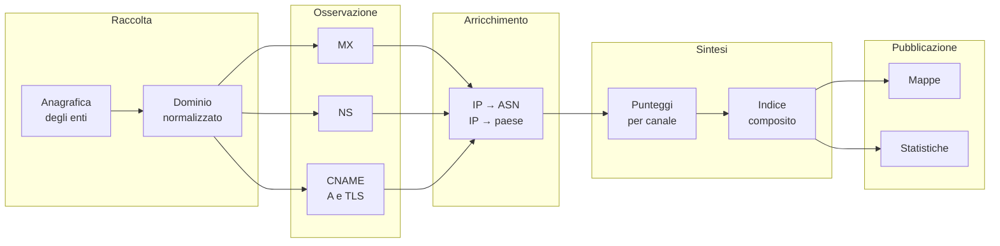

# Il racconto

## Un ente, un sito, tre infrastrutture

Immaginiamo di dover spiegare la presenza digitale di un ente pubblico a chi
non conosce il DNS. Potremmo dire: *l'ente ha un sito*. Ma quella frase nasconde
una catena di dipendenze.

Perché il sito sia raggiungibile, qualcuno deve rispondere alle domande sul
dominio. Perché l'ente possa ricevere una mail, qualcuno deve gestire la posta.
Perché il sito sia servito in modo sicuro, qualcuno deve emettere e mantenere un
certificato. Sono tre servizi distinti, spesso forniti da soggetti diversi, in
luoghi diversi.

L'Osservatorio attraversa questa catena e la racconta con tre domande.

### Prima domanda: dove viene gestita la posta?

Il record **MX** indica il server a cui va consegnata la posta di un dominio.
Dietro quel server c'è un provider, e dietro il provider c'è un'infrastruttura
di rete con un nome, un numero di sistema autonomo e una collocazione
geografica.

Quando l'Osservatorio dice che un ente ha la posta presso un certo provider, non
sta dicendo che quella sia una scelta buona o cattiva. Sta dicendo che, in quel
momento, le comunicazioni dell'ente passano da lì.

### Seconda domanda: chi controlla la delega DNS?

I record **NS** indicano i nameserver che amministrano una zona. Sono
l'equivalente digitale di un centralino: chi li controlla decide come il nome
dell'ente viene risolto, e quindi dove viene indirizzato il traffico.

La delega può essere gestita direttamente dall'ente, da un fornitore locale, da
un grande operatore internazionale o dal registro stesso. Anche in questo caso,
il dato racconta una dipendenza.

### Terza domanda: dove viene servito il sito?

Il record **A** associa un nome a un indirizzo IP. Un **CNAME** è un alias: dice
che un nome rimanda a un altro. Seguendo la catena degli alias si arriva al nome
finale, all'indirizzo effettivamente contattato e al certificato **TLS** che
protegge la connessione.

Qui compaiono spesso CDN e servizi cloud: il sito dell'ente può essere servito
da un'infrastruttura globale che si frappone tra l'utente e l'originario
fornitore. Il certificato può essere emesso da un'autorità pubblica, da una CDN
o da un cloud provider.

## Perché tre canali e non uno

Un singolo indicatore racconta poco. Un ente potrebbe avere un MX italiano ma
un DNS completamente esternalizzato; oppure un sito su una CDN globale ma una
posta gestita localmente. La combinazione dei tre canali permette di distinguere
situazioni molto diverse:

- **concentrazione**: tutti i servizi presso lo stesso fornitore;
- **distribuzione**: servizi presso fornitori diversi;
- **dipendenza da piattaforme globali**: presenza di hyperscaler o CDN
  internazionali in uno o più canali;
- **presenza di infrastruttura nazionale**: almeno una parte dei servizi
  ospitata in Italia o presso operatori italiani.

Nessuna di queste situazioni, da sola, è un giudizio. Sono configurazioni
infrastrutturali che aiutano a capire il grado di autonomia e di esposizione
dell'ente.

## La storia in otto passaggi

1. **Anagrafica.** L'elenco degli enti e i loro dati di contatto.
2. **Dominio.** Il sito istituzionale viene ridotto a un nome di host
   interrogabile.
3. **Posta.** Si individua il mail exchanger e il provider.
4. **DNS.** Si individua il nameserver della zona.
5. **Web.** Si segue la catena di alias fino all'indirizzo finale e al
   certificato.
6. **Rete.** Ogni IP viene associato a un sistema autonomo e a un paese.
7. **Sintesi.** I segnali diventano punteggi e poi un indice.
8. **Pubblicazione.** I dati diventano mappe e statistiche per il frontend.

## Che cosa significa "sovranità" qui

È importante chiarire che cosa l'Osservatorio **non** intende con questo
termine.

Non è un giudizio sulla legittimità o sulla qualità dell'azione
amministrativa. Non è una certificazione di sicurezza. Non è una misura della
capacità tecnica dei dipendenti dell'ente. Non è un confronto tra
amministrazioni.

È una **misura della collocazione e della concentrazione delle infrastrutture
digitali**. Risponde a domande come: i servizi dell'ente dipendono da un unico
fornitore? Da un fornitore estero? Da un paese extra-europeo? Da un hyperscaler?
Il DNS è gestito localmente o delegato altrove?

Queste informazioni sono utili per capire il livello di autonomia
infrastrutturale e per ragionare su rischi sistemici, ma non sostituiscono una
valutazione di sicurezza, di conformità o di qualità del servizio.

## Il risultato che il lettore vede

Il frontend non mostra il database. Mostra una rappresentazione:

- **mappe** con un punto per ogni ente geolocalizzato;
- **schede** con il provider della posta, il nameserver, la catena web e il
  certificato;
- **indicatori** sintetici per canale e per ente;
- **classifiche** di provider e concentrazione;
- **bande di sovranità** che collocano l'ente in una fascia.

Ogni elemento è il risultato di una catena di scelte documentata nei capitoli
successivi. Conoscerle è il modo migliore per non attribuire al dato un
significato che non ha.
