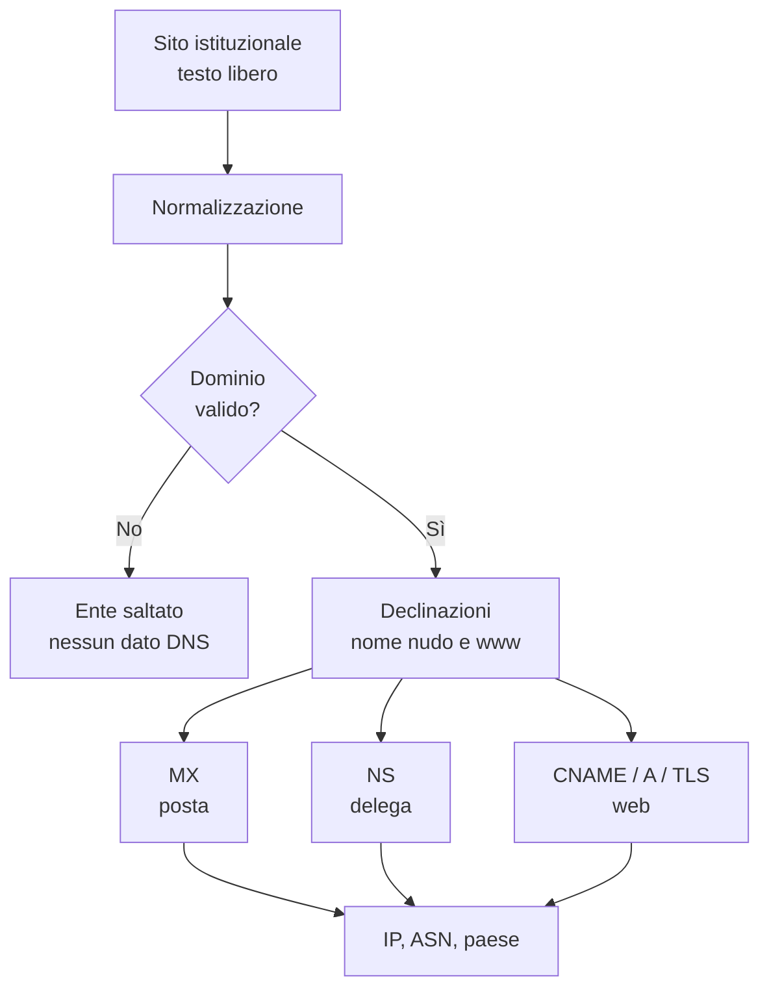

# Dall'ente al dominio

## Il campo più semplice e più insidioso

Il punto di partenza di tutta l'osservazione DNS è il campo `Sito_istituzionale`
dell'anagrafica. Sembra un dato semplice: il sito dell'ente. In realtà è un
campo libero, compilato in modi diversi nel tempo e da fonti diverse.

Può contenere:

- un URL completo, con schema e percorso;
- un dominio nudo;
- un dominio con `www`;
- un indirizzo con porta;
- un testo introduttivo, come *Sito ufficiale:*;
- una casella di posta, per errore o per abitudine;
- un valore non più valido.

Mandare direttamente questo valore a un resolver DNS non funziona. Il resolver
accetta un nome di host, non una frase, non un URL, non una casella di posta.
Prima di interrogare la rete serve quindi un passaggio di **normalizzazione**.

## Dal testo al nome di host

La normalizzazione segue una sequenza precisa. L'obiettivo è conservare
l'informazione utile e scartare tutto ciò che non descrive un dominio.

| Passaggio | Esempio | Risultato |
|---|---|---|
| Rimozione dello schema | `https://comune.esempio.it` | `comune.esempio.it` |
| Rimozione di `//` iniziale | `//comune.esempio.it` | `comune.esempio.it` |
| Estrazione da testo libero | `Sito ufficiale: comune.esempio.it` | `comune.esempio.it` |
| Taglio di percorso e query | `comune.esempio.it/servizi?x=1` | `comune.esempio.it` |
| Rimozione della porta | `comune.esempio.it:8080` | `comune.esempio.it` |
| Rimozione del punto finale | `comune.esempio.it.` | `comune.esempio.it` |
| Conversione in minuscolo | `Comune.Esempio.IT` | `comune.esempio.it` |

Alcuni valori vengono invece **respinti**:

- una casella di posta come `info@pec.esempio.it`, perché il dominio che segue
  la `@` appartiene al provider di posta, non all'ente;
- una stringa senza almeno due etichette, come `example` o `/`;
- un nome con etichette vuote, troppo lunghe o che iniziano o finiscono con un
  trattino;
- un valore senza un suffisso alfabetico plausibile.

L'eccezione è un URL con credenziali, del tipo `utente:password@host`: in quel
caso la `@` fa parte dell'URL e il dominio è comunque utilizzabile. La
distinzione evita di scartare un sito valido solo perché contiene una `@`.

Se dopo la normalizzazione non resta un nome di host valido, l'ente viene
saltato. Non è un errore del sistema: è il riconoscimento che quel valore non
descrive un dominio interrogabile. Nella pratica, l'ente resta nell'anagrafica
ma non riceve dati DNS per quella campagna.

## La questione del `www`

Molti siti pubblici rispondono solo su `www.esempio.it`, mentre il dominio nudo
non ha record. Altri fanno l'opposto. Per non perdere nessuno dei due casi, la
pipeline prova più **declinazioni** dello stesso nome:

| Dominio di partenza | Primo tentativo | Secondo tentativo |
|---|---|---|
| `comune.esempio.it` | `comune.esempio.it` | `www.comune.esempio.it` |
| `www.comune.esempio.it` | `www.comune.esempio.it` | `comune.esempio.it` |

L'ordine è importante. Il nome così com'è nel database viene sempre tentato per
primo: se funziona, il comportamento è identico a quello di un'osservazione
diretta. Il `www` è un **fallback**, non una sostituzione. Anche il nome salvato
nel database resta quello normalizzato, non la declinazione che ha prodotto il
risultato: sono i campi DNS a dire da quale nome è stata ottenuta la risposta.

Non vengono tentati altri prefissi come `admin`, `posta` o `intranet`. Sarebbe
un'enumerazione alla cieca, poco rispettosa della privacy e statisticamente
poco utile: il sito istituzionale è quasi sempre raggiungibile sul nome nudo o
su `www`.

## Un nome, tre percorsi

Una volta ottenuto il dominio, i tre canali di osservazione procedono in modo
indipendente. Questo è un punto cruciale per leggere i risultati.

Le declinazioni vengono applicate **per stadio**. Può succedere che:

- l'A record si trovi sul dominio nudo;
- il CNAME si trovi su `www`;
- il TLS sia raggiungibile solo su `www`.

In quel caso i campi provengono da nomi diversi, ed è corretto: descrivono
interrogazioni diverse, non una singola risposta. Il dato finale non va letto
come se tutti i campi provenissero dallo stesso host.

## Quando il sito cambia

Il dominio è l'input di tutta l'osservazione DNS. Se cambia, i dati raccolti in
precedenza diventano potenzialmente obsoleti. Per questo la pipeline mantiene
coerente il rapporto tra anagrafica e cache DNS:

- se un ente aggiorna il proprio `Sito_istituzionale`, i record DNS precedenti
  vengono rimossi e saranno rigenerati con il nuovo dominio;
- se un ente viene marcato come cancellato, i record DNS correlati vengono
  rimossi;
- la rimozione riguarda le tabelle DNS, non l'anagrafica: l'ente resta
  consultabile, ma senza dati DNS finché non viene nuovamente elaborato.

Questa scelta evita un errore frequente nei dataset incrementali: mostrare per
mesi il provider del vecchio sito come se fosse ancora quello attuale.

## Che cosa significa per il lettore

Quando un ente non ha dati DNS, o ne ha solo una parte, il frontend può
mostrarlo in modi diversi:

- **assente dalla mappa**, se mancano le coordinate;
- **presente ma senza uno o più canali**, se il dominio non ha prodotto
  risultati per quel canale;
- **non valutato**, se i dati non bastano per costruire l'indice.

Nessuno di questi casi indica automaticamente un problema dell'ente. Può
trattarsi di un sito non raggiungibile al momento dell'osservazione, di un
dominio particolare, di un errore di compilazione del campo o di una scelta
infrastrutturale che non produce i record attesi. La trasparenza su questo
punto è parte del metodo.
