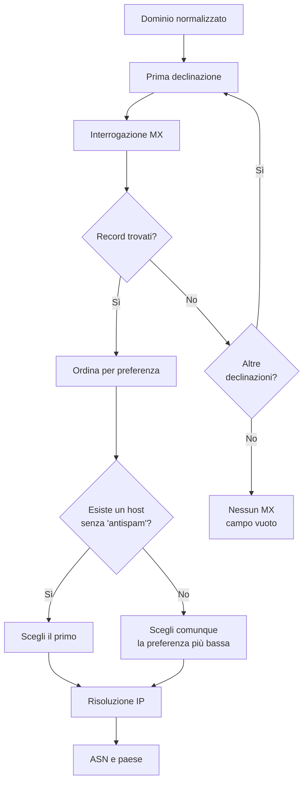

# La posta: MX

## Il centralino della posta elettronica

Quando si invia un messaggio a `protocollo@comune.esempio.it`, il sistema che
gestisce la posta deve sapere a quale server consegnarlo. Questa informazione è
pubblicata nel DNS attraverso i record **MX** (*Mail Exchanger*).

Un record MX contiene due elementi:

- il nome del server a cui consegnare la posta;
- una **preferenza**, un numero che indica l'ordine di priorità.

Preferenza più bassa significa maggiore priorità. Se il server preferito non è
disponibile, il mittente può provare i successivi.

Per l'Osservatorio il record MX è il primo indizio di dipendenza: dietro il
nome del server c'è un provider, e dietro il provider c'è un'infrastruttura di
rete con un sistema autonomo e una collocazione geografica.

## Come viene cercato il mail exchanger

La ricerca segue una sequenza lineare.

1. Si interroga il dominio per i record MX.
2. Si raccolgono le coppie server-preferenza e si ordinano per preferenza
   crescente.
3. Si sceglie il primo server il cui nome non contiene la parola `antispam`.
4. Se tutti i server contengono `antispam`, si sceglie comunque quello con la
   preferenza più bassa.
5. Se la prima declinazione non produce risultati, si prova la successiva.
6. Quando si trova un server, se ne risolve l'indirizzo IP.
7. L'indirizzo viene arricchito con ASN e paese.

### Perché il filtro `antispam`

Molte organizzazioni pubblicano come MX un'appliance antispam che riceve la
posta e la inoltra ai server interni. È un'informazione reale, ma racconta la
presenza di un filtro, non necessariamente il provider che gestisce la casella.
L'euristica prova quindi a privilegiare un server "pulito", se esiste.

Non è una regola assoluta. Se l'unico MX disponibile contiene `antispam`, viene
comunque usato: meglio un dato reale con un'avvertenza che nessun dato. Per
questo il nome del server va letto insieme al provider e al paese, non come
un'etichetta definitiva.

### Perché non si eredita il MX dal dominio padre

Un dominio senza record MX non usa automaticamente il mail exchanger del dominio
padre. Il comportamento corretto, descritto dalle norme della posta, è diverso:
un dominio senza MX può ricevere posta tramite il proprio record A, non tramite
quello del genitore.

Copiare l'MX di `esempio.it` su `comune.esempio.it` produrrebbe un dato falso:
il comune non usa quel server, e il nome del provider finirebbe nelle
statistiche come se fosse la sua infrastruttura. Per questo la ricerca MX non
risale mai la gerarchia. È una differenza importante rispetto ai nameserver,
dove invece la risalita è corretta perché la delega è reale.

## Dall'host all'infrastruttura

Trovato il server MX, si apre la seconda parte del lavoro: capire dove si trova.

- **IP**: si risolve il nome del server in un indirizzo IPv4.
- **Fallback**: se il nome non ha un indirizzo, si prova la variante `www` o la
  variante senza `www`, con lo stesso criterio usato per il dominio.
- **ASN**: l'indirizzo viene associato a un sistema autonomo, cioè a un
  provider di rete.
- **Paese**: l'indirizzo viene collocato geograficamente tramite il database
  GeoIP.

Il risultato è una catena leggibile: dominio → server MX → indirizzo IP →
provider → paese.

## Che cosa vede il lettore

Nel frontend, il canale della posta può mostrare:

- il nome del server MX;
- la priorità;
- l'indirizzo IP;
- il provider di rete;
- il paese e il continente;
- il punteggio della dimensione posta.

La scheda di un ente può quindi dire, per esempio, che la posta è gestita da un
provider italiano, oppure da un grande operatore internazionale, oppure che non
è stato possibile osservare un MX.

## Come leggere il dato

**Un MX italiano non garantisce che i dati restino in Italia.** Il provider può
avere sede italiana e infrastrutture distribuite altrove. Il paese osservato è
quello dell'indirizzo IP del server, non necessariamente quello in cui vengono
conservati i messaggi.

**Un MX estero non è automaticamente un problema.** Può essere una scelta
consapevole, un servizio condiviso, un provider specializzato. Il dato descrive
una dipendenza, non la valuta.

**L'assenza di MX non prova che l'ente non abbia posta.** Il dominio potrebbe
usare il proprio record A come MX implicito, oppure il record potrebbe non
essere stato osservabile al momento della query. Il campo vuoto va letto come
"non osservato", non come "inesistente".

**La priorità non è una misura di qualità.** Indica solo l'ordine di preferenza
dichiarato dal dominio. Un valore basso non significa un servizio migliore.

**Il filtro antispam è un'euristica.** Se il server scelto contiene `antispam`,
il dato va interpretato con maggiore cautela: potrebbe descrivere il filtro
perimetrale più che il provider finale della casella.
