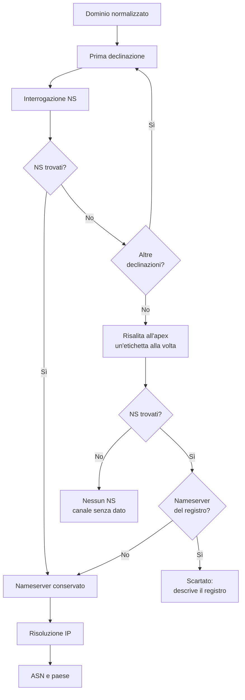

# La delega: NS

## Chi risponde per un dominio

Ogni volta che un browser deve raggiungere un sito, prima ancora di sapere
quale indirizzo contattare, deve chiedere al DNS chi amministra quel nome. La
risposta è contenuta nei record **NS** (*Name Server*): l'elenco dei server
autorevoli per una zona.

È il livello più profondo della dipendenza digitale. Chi controlla i
nameserver controlla la mappa che traduce il nome dell'ente in un indirizzo.
Può cambiare destinazione, introdurre un filtro, rendere il nome irraggiungibile.
Non è necessariamente chi ospita il sito: è chi decide dove il sito viene
cercato.

Per l'Osservatorio, il canale NS risponde a una domanda precisa: **la
risoluzione del dominio dell'ente è gestita direttamente, da un fornitore
italiano, da un grande operatore internazionale o dal registro stesso?**

## La ricerca non è una sola query

Un nameserver non è necessariamente pubblicato sul nome che interessa
all'ente. I record NS esistono solo all'**apex** della zona, cioè al livello in
cui la zona è stata delegata. Un sottodominio come `latina.cri.it` non ha
record NS propri: è servito dai nameserver di `cri.it`, che è la zona
effettivamente delegata.

La ricerca segue quindi una progressione.

1. Si prova il dominio così com'è stato normalizzato.
2. Se non produce NS, si prova la declinazione con `www`.
3. Se nessuna declinazione ha NS propri, si risale la gerarchia togliendo
   un'etichetta alla volta, fino a trovare una zona delegata.
4. La risalita si ferma prima del dominio di primo livello: i nameserver del
   TLD appartengono al registro, non all'ente.
5. Trovato il nameserver, se ne risolve l'indirizzo IP.
6. L'indirizzo viene arricchito con sistema autonomo e paese.

### Perché la risalita è corretta per NS e non per MX

La differenza rispetto alla posta è sostanziale. Un record MX non si eredita
dal dominio padre: un dominio senza MX non usa automaticamente il server del
genitore. La delega NS, invece, è realmente gerarchica: se un sottodominio non
ha una zona propria, è per definizione servito dalla zona che lo contiene.

Risalire è quindi fedele alla struttura del DNS. Il risultato, però, va letto
con attenzione: descrive il nameserver della zona in cui il dominio si trova,
non necessariamente un nameserver scelto dall'ente.

## Il caso dei registri `.edu.it` e `.gov.it`

Esiste un caso in cui la risalita produrrebbe un dato formalmente vero ma
inutile. Migliaia di scuole italiane hanno un dominio sotto `.edu.it`, e
alcuni enti hanno un dominio sotto `.gov.it`. Queste zone non sono deleghe
individuali: sono categorie amministrate dal registro, con nameserver condivisi
come `a.dns.it`, `m.dns.it` e `r.dns.it`.

Se l'Osservatorio registrasse quei nameserver, assegnerebbe lo stesso provider
a migliaia di enti che non hanno alcun rapporto diretto con quel provider.
L'indicatore misurerebbe il registro, non l'amministrazione. Per questo i
nameserver riconducibili al registro vengono **scartati** quando la risalita
arriva a un'apex come `edu.it` o `gov.it`.

La conseguenza è che per una parte di questi enti il canale NS resta senza un
nameserver utile. Non è un errore e non è un dato mancante per negligenza: è
una scelta esplicita per non attribuire all'ente un'infrastruttura che non
controlla. Il canale NS, in quel caso, non riceve credito da un nameserver del
registro.

## Quale nameserver viene conservato

Quando la zona espone più nameserver, l'Osservatorio ne conserva uno solo,
chiamato per comodità **primario**. Il termine non va inteso in senso tecnico:
nel DNS non esiste un nameserver "principale" con priorità paragonabile a
quella di un record MX. La scelta avviene per ordine alfabetico tra i nomi
restituiti.

È un'euristica dichiarata, non una gerarchia reale. Serve a rendere il dato
confrontabile e a evitare che un ente con tre nameserver pesi tre volte tanto
di un ente con uno solo. Ma significa anche che il nameserver mostrato è un
campione rappresentativo della zona, non necessariamente quello che l'ente
considera principale.

Se il nameserver non ha un indirizzo IP, si tenta la variante `www` del suo
nome, con lo stesso criterio usato per i domini. Se anche quel tentativo
fallisce, il nameserver resta senza IP e senza provider: il record esiste, ma
il canale non può essere arricchito.

## Che cosa vede il lettore

Nel frontend, il canale DNS può mostrare:

- il nome del nameserver conservato;
- il suo indirizzo IP;
- il provider di rete;
- il paese e il continente;
- il punteggio della dimensione DNS.

La scheda di un ente può quindi dire che la risoluzione è affidata a un
operatore italiano, a un grande provider internazionale, a una CDN o a un
servizio cloud. In alcuni casi può non mostrare alcun nameserver utile, e
questo è un'informazione tanto quanto le altre.

## Come leggere il dato

**NS non significa hosting.** Il nameserver gestisce la risoluzione del nome,
non i file del sito né la casella di posta. Un ente può avere NS italiani e
sito ospitato all'estero, o viceversa.

**Lo stesso provider su più canali è un segnale di concentrazione.** Se MX, NS
e CNAME puntano allo stesso sistema autonomo, l'ente dipende da un unico
fornitore per funzioni diverse. È la situazione che le statistiche chiamano
*lock-in alto*.

**Un NS del registro non dice che l'ente non gestisca il proprio DNS.** Dice
che la delega della zona è del registro. La gestione operativa può essere
altrove, ma non è osservabile da questo canale.

**Il paese è quello dell'indirizzo IP del nameserver.** Non coincide
necessariamente con il luogo in cui risiede la zona né con la nazionalità del
fornitore.

**La data conta.** Una delega può cambiare senza che cambi il nome del
dominio. Il dato riflette l'ultima osservazione disponibile, non una condizione
permanente.
