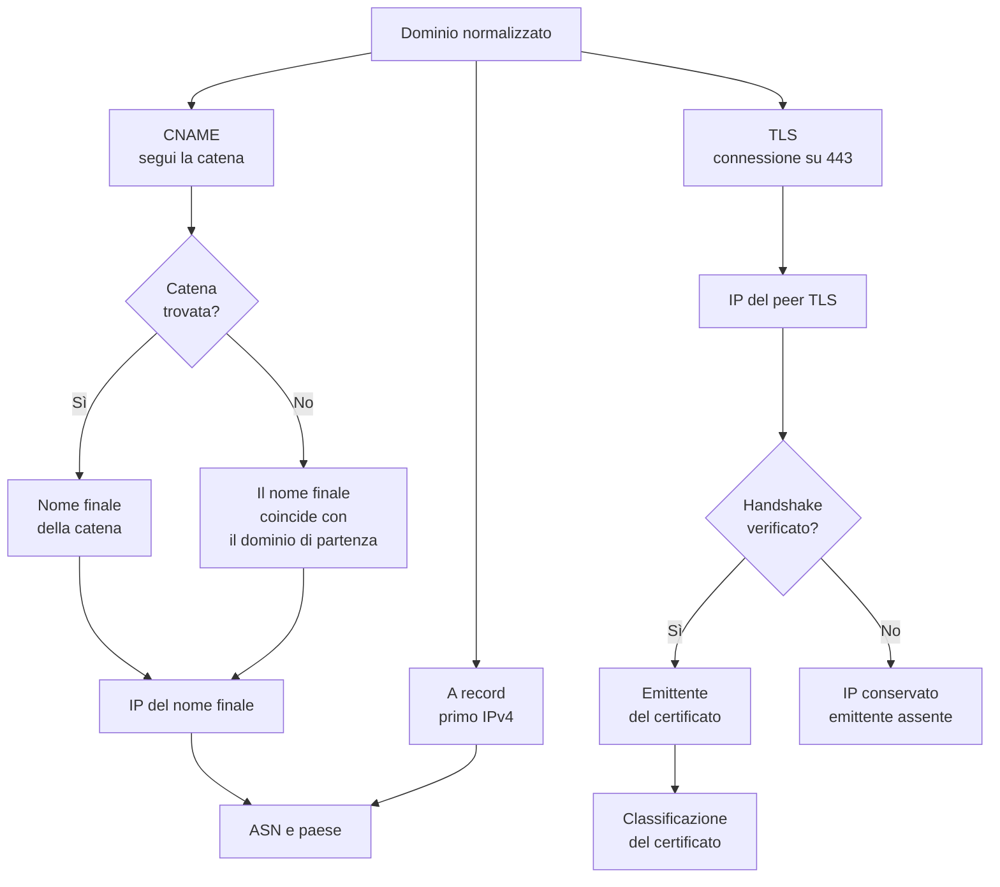

# Il volto web: CNAME e TLS

## Dove viene servito il sito

La posta ha un centralino, il DNS ha una delega, il web ha un **punto di
contatto**. Quando un utente apre il sito dell'ente, il browser risolve il nome
in un indirizzo, apre una connessione cifrata e riceve una pagina. Lungo questa
strada possono comparire alias, CDN, bilanciatori e certificati.

Il canale web dell'Osservatorio ricostruisce quel percorso in tre tappe
indipendenti:

1. l'indirizzo **A**, cioè l'IPv4 a cui il nome viene risolto;
2. la catena **CNAME**, cioè gli alias che portano dal nome dell'ente al nome
   finale;
3. il certificato **TLS**, cioè l'identità crittografica presentata dal server
   sulla porta 443.

Sono tre osservazioni diverse. Possono riguardare lo stesso host, oppure host
diversi, a seconda di come il dominio è configurato.

## La catena degli alias

Un record CNAME è un rinvio: dice che un nome non ha un indirizzo proprio ma
deve essere risolto altrove. I rinvii possono concatenarsi. L'Osservatorio
segue la catena fino al nome finale, con un limite di profondità e un controllo
dei loop.

La catena viene seguita a partire dalla prima declinazione che espone un alias
reale. Se nessuna declinazione ha un CNAME, il nome finale coincide con il
dominio di partenza.

Questo dettaglio è importante per leggere il dato: **il campo del nome finale
non dimostra che l'ente usi un CNAME**. È il punto di arrivo della risoluzione
web. Un sito senza alias avrà come nome finale il proprio dominio; un sito
dietro una CDN avrà come nome finale un host della CDN.

## A, CNAME e TLS possono venire da nomi diversi

Le declinazioni del dominio — nome nudo e `www` — vengono provate **per ogni
tappa**, in modo indipendente. Può succedere che:

- l'indirizzo A si trovi sul dominio nudo;
- il CNAME si trovi su `www`;
- il TLS risponda solo su `www`.

In quel caso i tre campi descrivono tre interrogazioni diverse, ed è corretto
così. Non vanno letti come se provenissero tutti dallo stesso host. Il dominio
memorizzato resta quello normalizzato; sono i campi osservati a dire da quale
declinazione è arrivata la risposta.

## Il certificato non è solo un dettaglio di sicurezza

Il certificato TLS dice chi ha emesso le credenziali del server. È
un'informazione infrastrutturale, non solo tecnica: un certificato emesso da
una CDN racconta che la CDN termina la connessione; un certificato emesso da un
cloud provider racconta che il servizio è integrato in quella piattaforma; un
certificato emesso da un'autorità pubblica generica racconta un rapporto più
tradizionale.

L'Osservatorio conserva due elementi:

- l'**emittente**, cioè l'organizzazione che compare nel certificato;
- una **classificazione** dell'emittente in categorie: autorità pubblica, CDN,
  cloud, rivenditore, sconosciuto.

La classificazione non è un giudizio sulla qualità del certificato. Serve a
capire se il punto di terminazione TLS appartiene a un'infrastruttura
specializzata o a un'autorità indipendente.

### Perché l'IP TLS può esserci anche senza emittente

La connessione sulla porta 443 stabilisce subito l'indirizzo del peer. Quello è
il server che termina TLS, e l'informazione è disponibile anche se il
certificato è scaduto, self-signed o emesso per un altro nome.

L'emittente, invece, richiede un handshake riuscito e verificato. Se la
verifica fallisce, l'IP resta e l'emittente no. È una distinzione voluta: un
certificato non valido non deve cancellare il fatto che quel server risponde
sulla 443.

Esiste anche una modalità permissiva, usata solo per recuperare dati in
situazioni particolari. Non è il comportamento normale, perché un certificato
non verificato non è confrontabile con uno verificato: cambierebbe il
significato del campo e mescolerebbe osservazioni raccolte con criteri diversi.

## Che cosa vede il lettore

Per il canale web, la scheda di un ente può mostrare:

- il nome finale della risoluzione;
- l'indirizzo IP associato;
- il provider di rete e il paese;
- l'emittente del certificato e la sua categoria;
- il punteggio della dimensione web.

In molti casi il nome finale e l'IP appartengono a una CDN o a un cloud. È il
dato più frequente e anche il più delicato da interpretare.

## Come leggere il dato

**Il punto osservato è il bordo, non necessariamente l'origine.** Quando il
sito è dietro una CDN, l'indirizzo e il certificato appartengono al nodo che
serve l'utente. Il server che conserva i contenuti può trovarsi altrove, anche
in un altro paese. L'Osservatorio misura la facciata visibile, non
l'infrastruttura di origine.

**Un CNAME verso una CDN non dice dove sono i dati.** Dice che il traffico web
passa da quella CDN. La localizzazione dei contenuti e dei database è un'altra
storia, spesso non osservabile dal DNS.

**La classificazione dell'emittente è un'euristica.** Si basa sul nome
dell'organizzazione nel certificato e su un insieme finito di parole chiave.
Un'autorità non elencata finisce tra gli sconosciuti, anche se è perfettamente
legittima.

**L'assenza di CNAME non è un errore.** Un sito può essere servito direttamente
dal proprio dominio. In quel caso il nome finale coincide con il dominio e il
canale web descrive comunque un'informazione utile: il provider dell'IP e il
certificato.

**Un certificato mancante non prova che il sito sia insicuro.** Può dipendere
da un errore temporaneo, da una configurazione particolare, da un blocco di
rete o da un certificato non verificabile. Il campo vuoto va letto come "non
osservato", non come "assente".

**La data dell'osservazione è parte del dato.** Certificati e CDN cambiano
spesso. Un'informazione raccolta mesi prima può non descrivere la
configurazione attuale.
