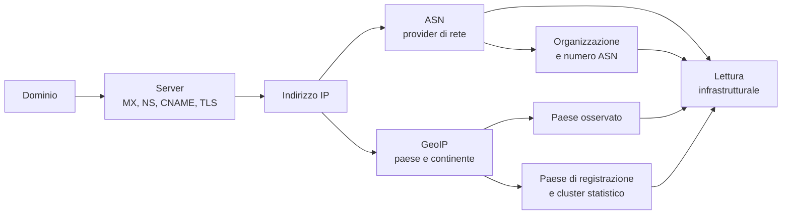

# L'infrastruttura: ASN e GeoIP

## Da un indirizzo IP a un soggetto e a un luogo

I capitoli precedenti producono indirizzi IP: l'IP del server di posta, del
nameserver, del nome finale del web, del peer TLS. Un indirizzo IP, da solo,
non dice molto. Per interpretarlo servono due informazioni:

- **chi** gestisce la rete in cui l'indirizzo vive;
- **dove** quella rete è collocata.

L'Osservatorio le ottiene da due basi di dati geografiche e di rete: la
mappatura dei sistemi autonomi e la mappatura dei paesi. Il risultato è la
catena che rende leggibile tutto il resto:

## Il sistema autonomo

Un **ASN** (*Autonomous System Number*) identifica una rete amministrata da un
unico soggetto, con proprie politiche di routing. In termini pratici, è il
modo in cui Internet raggruppa gli indirizzi IP sotto un operatore: un provider
di accesso, un cloud, una CDN, un'azienda con una rete propria.

L'Osservatorio conserva il numero e il nome dell'organizzazione associata. Il
nome è ciò che il lettore vede nella scheda e nelle classifiche: per esempio
l'operatore che gestisce la posta o il nameserver.

Questo passaggio è ciò che trasforma un elenco di indirizzi in una mappa di
soggetti. Senza ASN, un sito dietro un IP qualsiasi sarebbe indistinguibile da
un sito dietro un IP qualsiasi. Con ASN, si può dire che due enti usano lo
stesso provider, che un ente ha tutti i servizi su un'unica infrastruttura,
che una quota rilevante del perimetro dipende da pochi grandi operatori
globali.

### Che cosa l'ASN non dice

L'ASN identifica la rete, non il contratto. Un ente può avere un servizio
ospitato presso un certo fornitore e comparire sotto l'ASN di un altro soggetto
che gestisce la rete per conto del primo. Allo stesso modo, un grande gruppo
può avere più ASN, e due società dello stesso gruppo possono comparire con nomi
diversi.

L'ASN è quindi un'ottima approssimazione della **dipendenza di rete**, ma non
è un registro contrattuale. Va letto come un indizio forte, non come una prova
di chi ha firmato il servizio.

## Il paese e il continente

La seconda informazione è la collocazione geografica dell'indirizzo. Per ogni
IP vengono conservati:

- il **paese** osservato;
- il **continente**;
- il **paese di registrazione** del blocco di indirizzi;
- la **fonte** dell'informazione, cioè se il paese è stato letto direttamente
  dalla banca dati geografica, ricavato dal paese di registrazione oppure non
  è disponibile.

La distinzione tra paese osservato e paese di registrazione nasce da un
problema concreto: le reti **anycast**, tipiche delle CDN, annunciano lo stesso
indirizzo da più parti del mondo. Per alcuni di questi intervalli la banca dati
non sa indicare un paese unico, ma conosce il paese in cui il blocco è
registrato. In quel caso il paese di registrazione viene usato come fallback,
e la fonte del dato lo dichiara.

### Il cluster statistico

Per le statistiche, gli indirizzi vengono anche raggruppati in quattro
categorie:

| Cluster | Significato |
|---|---|
| IT | Il blocco è registrato in Italia |
| UE | Il blocco è registrato in un paese dell'Unione Europea diverso dall'Italia |
| USA | Il blocco è registrato negli Stati Uniti |
| Extra UE | Il blocco è registrato fuori dall'Unione Europea e dagli Stati Uniti |
| unknown | Il paese di registrazione non è disponibile |

Il cluster è calcolato sul **paese di registrazione**, non sul paese osservato.
È una scelta metodologica: rende le quote confrontabili anche quando la banca
dati geografica non riesce a localizzare un indirizzo anycast. Ma significa
anche che le percentuali "in Italia" e "fuori UE" delle statistiche non vanno
lette come la posizione fisica del server in quel momento. Per gli indirizzi
anycast, e in particolare per quelli delle CDN, la differenza può essere
significativa.

## Quali indirizzi vengono arricchiti

Non tutti gli IP del mondo: solo quelli referenziati dai canali osservati.
Vengono considerati gli indirizzi della posta, dei nameserver, del nome finale
web, del record A e del peer TLS. Un indirizzo che non compare in nessuna di
queste posizioni non viene elaborato.

L'arricchimento è incrementale. Un IP già noto non viene rielaborato, a meno
che la sua riga non sia incompleta. Questo mantiene sostenibile il lavoro e
permette di aggiungere nuovi indirizzi senza ricalcolare l'intero patrimonio.

## Il punto sulla mappa non è il provider

Questa è una delle distinzioni più importanti per chi guarda le mappe.

Il punto geografico associato a un ente rappresenta **la sede dell'ente**, non
la posizione del provider, del server o del datacenter. Le coordinate derivano
dall'anagrafica e dalla localizzazione del comune o del CAP. Il provider e il
paese dell'infrastruttura compaiono nella scheda e nel popup, non spostano il
punto.

Un ente con sede in un piccolo comune e posta su un cloud americano apparirà
nel piccolo comune, con un'indicazione di provider americano nella scheda. La
mappa risponde alla domanda "dove sono gli enti", non "dove sono i loro
server". Per la seconda domanda servirebbe una mappa diversa, con i punti degli
IP e delle infrastrutture.

## Che cosa vede il lettore

Per ogni canale, la scheda può mostrare:

- l'indirizzo IP osservato;
- il numero e il nome del sistema autonomo;
- il paese e il continente;
- il cluster di registrazione;
- le stesse informazioni per il peer TLS, quando disponibili.

Le classifiche di concentrazione usano il nome dell'organizzazione. Le quote
geografiche usano il cluster. Le mappe usano la posizione dell'ente.

## Come leggere il dato

**Paese dell'IP non significa paese dei dati.** Un server può essere in Italia
e conservare dati altrove, o essere all'estero e conservare dati in Italia. La
residenza dei dati dipende dal contratto e dall'architettura del servizio, non
dall'indirizzo del nodo che risponde.

**Anycast e CDN confondono la geografia.** Un indirizzo può essere annunciato
da più continenti. Il paese osservato è quello che la banca dati associa
all'indirizzo, non necessariamente quello in cui si trova il server che ha
servito la richiesta.

**L'ASN è una rete, non un'azienda.** Grandi gruppi possono avere più ASN e
nomi diversi. Piccoli fornitori possono comparire sotto l'ASN di un partner.

**La fonte del dato è dichiarata.** Un paese letto direttamente e un paese
ricavato dalla registrazione non hanno lo stesso grado di certezza. La
differenza è conservata nel dato e va tenuta presente quando si analizzano le
quote geografiche.

**L'arricchimento è incrementale.** Un IP nuovo viene elaborato; uno già noto
non viene aggiornato a ogni esecuzione. La fotografia geografica può quindi
contenere informazioni di date diverse.

## Dove finiscono questi dati

Gli IP arricchiti alimentano anche il layer aggregato per paese:
`poi_ip_country.geojson`. Una feature per paese riassume i record dei cinque
canali e gli enti distinti, con il punto sul centroide del paese. Il modello di
conteggio, il filtro `country_source = 'geoip'` e il significato delle quote
sono descritti in [La mappa: gli IP per paese](07b-mappa-ip-paesi.md).
