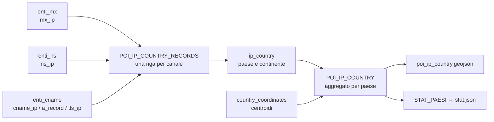

# La mappa: gli IP per paese

## Una feature per paese

Le mappe degli enti collocano ogni ente nel proprio comune. Il layer
`poi_ip_country.geojson` risponde a una domanda diversa: **dove sono gli
indirizzi IP osservati**, aggregati per paese.

Il layer non contiene un punto per IP né un punto per ente. Contiene **una
feature per paese**: il punto è il centroide del paese, mentre i contatori
descrivono quanti record e quanti enti distinti fanno riferimento a quel
paese nei cinque canali osservati (MX, NS, CNAME, A e TLS).

## Le tabelle coinvolte

### `ip_country`

Contiene la geolocalizzazione degli indirizzi IP. Per ogni IP conserva il
paese, il continente, il paese di registrazione, il cluster statistico e la
**fonte** del dato (`country_source`).

Il layer usa solo gli IP con `country_source = 'geoip'`, cioè quelli per cui
la banca dati geografica ha indicato direttamente un paese. Restano fuori:

- gli IP il cui paese è stato ricavato dal paese di registrazione
  (`country_source = 'registered'`);
- i record senza un paese valorizzato;
- i record senza indirizzo IP.

La scelta è deliberata: il layer racconta la geografia **osservata**, non
quella dedotta dal blocco di indirizzi. La fonte del dato resta comunque
disponibile in `ip_country` per le altre letture.

### `country_coordinates`

È la tabella statica dei centroidi dei paesi. Contiene:

| Colonna | Significato |
|---|---|
| `alpha2` | Codice ISO 3166-1 alpha-2 (es. `IT`, `US`) |
| `alpha3` | Codice ISO 3166-1 alpha-3 (es. `ITA`, `USA`) |
| `latitude` | Latitudine del centroide, in gradi decimali |
| `longitude` | Longitudine del centroide, in gradi decimali |
| `name` | Nome del paese nella tabella dei centroidi |

La tabella viene caricata da `00 - Input/country-centroids.xlsx`, a sua volta
derivato dal CSV `00 - Input/country-centroids/country-centroids.csv`. Le
coordinate sono in **gradi decimali** e possono essere negative: il layer
paese non usa il vincolo "latitudine e longitudine non negative" previsto per
la sola Italia.

Stato attuale: 245 righe, 244 codici `alpha2` distinti e 244 utilizzabili. La
Namibia ha `alpha2` mancante e quindi non è agganciabile per codice. Tutti i
28 paesi presenti in `ip_country` hanno invece una corrispondenza valida.

L'aggancio tra `ip_country` e `country_coordinates` avviene su
`ip_country.country_code = country_coordinates.alpha2`.

## Il modello di conteggio

La vista `POI_IP_COUNTRY_RECORDS` mette in fila i cinque canali:

| Canale | Tabella | Colonna IP |
|---|---|---|
| MX | `enti_mx` | `mx_ip` |
| NS | `enti_ns` | `ns_ip` |
| CNAME | `enti_cname` | `cname_ip` |
| A | `enti_cname` | `a_record` |
| TLS | `enti_cname` | `tls_ip` |

Ogni riga della vista è un **record di canale** con un paese. La vista
`POI_IP_COUNTRY` aggrega poi per `country_code` e produce:

| Proprietà | Significato |
|---|---|
| `country_code` | Codice ISO alpha-2 |
| `country_name` | Nome del paese come restituito da GeoIP |
| `continent` | Continente |
| `mx` | Record MX associati al paese |
| `ns` | Record NS associati al paese |
| `cname` | Record CNAME associati al paese |
| `a` | Record A associati al paese |
| `tls` | Record TLS associati al paese |
| `enti_totali` | Enti distinti del paese sui cinque canali |

I contatori **non contano indirizzi IP distinti**. Contano record: lo stesso
IP può comparire in più canali e contribuire quindi a più contatori. Per
esempio, un ente che usa lo stesso indirizzo per posta e nameserver alimenta
sia `mx` sia `ns`.

`enti_totali` è invece un conteggio distinto per ente: un ente che compare su
più canali nello stesso paese viene contato una volta sola.

## Perché le quote non sono additive

Un ente può avere servizi in più paesi: la posta in Italia, il web su una CDN
americana, i nameserver in un terzo paese. Per questo la somma degli
`enti_totali` di tutti i paesi **non è** il numero di enti del perimetro.

I numeri del perimetro attuale:

| Misura | Valore |
|---|---|
| Enti distinti con almeno un IP `geoip` | 21.962 |
| Associazioni paese-ente (somma degli `enti_totali`) | 35.378 |
| Enti distinti con almeno un IP, tutte le fonti | 22.054 |

Il layer e le quote di `stat.json` usano **21.962** come denominatore, perché
è il perimetro effettivo del file pubblicato. Il totale a monte è 22.054: i
92 enti in più hanno solo IP il cui paese è stato ricavato dal paese di
registrazione (`country_source = 'registered'`) e quindi non compaiono nella
mappa. La differenza è dichiarata qui e non va interpretata come un errore di
conteggio.

## Il file `poi_ip_country.geojson`

Il file viene generato da `06 - BuildGeojson/Generate_geojson.py` con la voce
`IP_COUNTRY` della configurazione. Il nome è tutto minuscolo, come gli altri
GeoJSON del frontend.

Ogni feature ha una geometria `Point` con le coordinate del centroide e le
proprietà elencate nella tabella del modello di conteggio. Il file contiene
solo i paesi con almeno un contatore valorizzato.

### Metadati

Il `FeatureCollection` include un blocco `metadata` con:

- `layer`, `file` e `feature_count`;
- `generated_at`, in formato ISO 8601 con fuso `Europe/Rome`;
- `source`, cioè la vista e il filtro usati;
- `perimeter`, la descrizione delle righe incluse e di quelle escluse;
- `counting`, la regola dei contatori e dell'`enti_totali`;
- `caveats`, le avvertenze per chi legge il dato.

I metadati sono pensati per rendere il file leggibile senza dover
ricostruire le regole dal codice.

### Paesi senza coordinate

Se un paese presente nei dati non ha una riga valida in
`country_coordinates`, oppure ha coordinate fuori dall'intervallo mondiale
(`-90..90` per la latitudine, `-180..180` per la longitudine), il paese viene
**escluso dal GeoJSON**. Il generatore riporta nel log il codice e il nome dei
paesi scartati: non è un silenzio, è un'informazione da verificare.

La scelta di escludere il paese, invece di disegnarlo con coordinate
sentinella, evita di mostrare un punto in mezzo all'oceano come se fosse una
posizione reale.

## La sezione `paesi` di `stat.json`

`07 - StatsJson/StatJson.py` aggiunge la sezione **Distribuzione geografica
(IP)** subito dopo la sezione CNAME. Contiene:

- il numero di **paesi coinvolti**;
- il numero di **enti del perimetro con IP geoIP** (21.962);
- la **TOP 10** dei paesi per enti distinti, con nome e conteggio.

Il frontend calcola la quota di ogni paese sul totale `21.962` della card. Il
sottotitolo dichiara esplicitamente che un ente può comparire in più paesi e
che quindi la somma delle righe non coincide con il totale.

La vista `STAT_PAESI` espone gli stessi dati lato database, con la percentuale
già calcolata sul perimetro `geoip`. La percentuale serve per controlli e
reportistica; il frontend usa il conteggio e il totale della card.

## Come leggere il dato

**Il paese è quello dell'IP, non quello dell'ente.** Un ente con sede in
Italia può avere la posta negli Stati Uniti e il web in Irlanda. La mappa
degli enti e la mappa degli IP rispondono a due domande diverse.

**Il centroide non è la posizione del server.** Il punto è il centro del
paese, non l'indirizzo fisico dell'infrastruttura. Serve a dare una posizione
leggibile sulla mappa, non a localizzare il singolo server.

**Anycast e CDN confondono la geografia.** Lo stesso indirizzo può essere
annunciato da più parti del mondo. Il paese `geoip` è quello che la banca dati
associa all'indirizzo, non necessariamente quello in cui si trova il server
che ha risposto.

**Le quote non sono additive.** La somma degli enti per paese è maggiore del
numero di enti distinti, perché un ente può comparire in più paesi. Per
leggere la concentrazione usare il denominatore del perimetro, non la somma
delle righe.

**La fonte del dato è dichiarata.** Il layer usa solo `country_source =
'geoip'`. Gli IP con paese ricavato dalla registrazione restano in
`ip_country`, ma non entrano in questa mappa: il loro grado di certezza è
diverso e va trattato separatamente.
