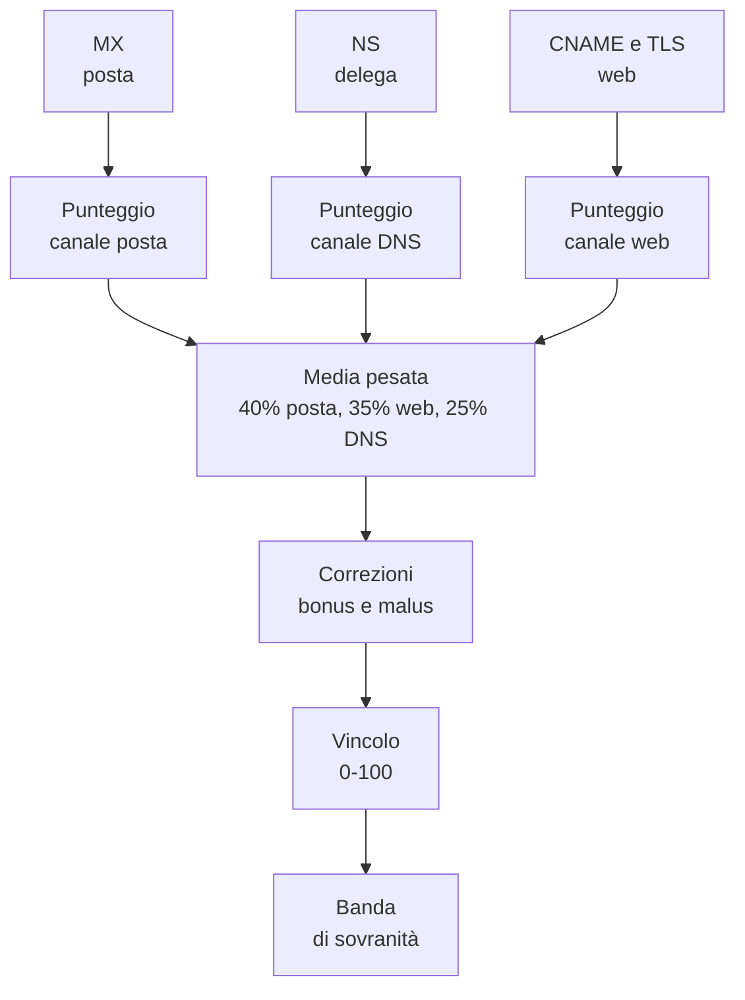

# La sintesi: ISDPA

## Da tre osservazioni a un indice

I canali MX, NS e CNAME raccontano tre storie parziali. L'**Indice di
Sovranità Digitale della Pubblica Amministrazione** (ISDPA) le mette insieme in un unico numero, con l'obiettivo
di rispondere a una domanda sintetica: quanto è autonoma, distribuita o
dipendente l'infrastruttura digitale di un ente?

L'indice non è una media di tutto ciò che è stato osservato. È una
costruzione con scelte precise: quali dimensioni contano, quanto pesano, come
si trattano i dati mancanti, quali correzioni applicare. Conoscerle è
indispensabile per non leggere il numero come se fosse una misura oggettiva
della realtà.

!!! note "Nomi tecnici"
    L'indice è oggi denominato **ISDPA**. Restano invariati per compatibilità
    i nomi tecnici storici `05 - ISDC/`, `isdc.py`, `isdc_scores`, `POI_ISDC`
    e `poi_isdc.geojson`.

## Il cancello d'ingresso

Prima di calcolare l'indice, un ente deve superare un cancello. Le condizioni
sono tre:

1. avere un sito istituzionale valorizzato;
2. avere dati DNS utilizzabili per i canali richiesti;
3. non avere già un punteggio calcolato.

La prima condizione è ovvia: senza dominio non c'è nulla da osservare. La
seconda merita attenzione. Se un canale non ha dati, il sistema potrebbe
produrre un valore intermedio che sembra una misura ma non lo è. Il valore
neutro, in assenza di osservazioni, è circa **42,4**: un numero plausibile,
indistinguibile da un punteggio reale. Per questo il cancello richiede che i
dati esistano davvero.

La terza condizione riguarda il ciclo di vita. Il calcolo è **incrementale**:
un ente già valutato non viene ricalcolato automaticamente. Per aggiornarlo
bisogna rimuovere il suo punteggio e rimetterlo in coda. È una scelta di
efficienza, ma ha una conseguenza importante: l'indice di un ente può
invecchiare anche se la pipeline continua a girare.

## Il punteggio di un canale

Ogni canale produce un punteggio da 0 a 100 attraverso tre passaggi.

### 1. Le dimensioni del canale

Per la **posta** e per la **delega DNS** contano due dimensioni:

- la **collocazione geografica** dell'indirizzo, con peso 60%;
- la **natura del provider**, con peso 40%.

Per il **web** le dimensioni sono tre:

- la collocazione geografica, con peso 50%;
- la natura del provider, con peso 30%;
- la **classificazione del certificato**, con peso 20%.

Il certificato entra solo nel canale web perché è l'unico in cui è osservabile
in modo significativo. La posta e il DNS non espongono un certificato TLS
comparabile.

### 2. La pagella geografica

La collocazione dell'IP viene tradotta in un valore tra 0 e 1:

| Situazione | Valore |
|---|---|
| Italia | 1,00 |
| Unione Europea | 0,85 |
| Altri paesi europei | 0,70 |
| Altri continenti | 0,50 |
| Cina o Russia | 0,25 |
| Paese non determinato | 0,30 |

Cina e Russia hanno una penalità esplicita e vengono valutate **prima** del
continente. È una scelta necessaria: la banca dati geografica colloca la
Russia nel continente europeo, quindi un controllo basato solo sul continente
la renderebbe indistinguibile dalla Francia o dalla Germania.

La scala non è una classificazione giuridica. È una graduazione di distanza
infrastrutturale: l'Italia vale il massimo, l'Unione Europea è considerata
vicina, il resto del mondo è considerato più distante, e due paesi con
restrizioni note ricevono una penalità più forte. I valori sono una scelta
metodologica, non una misura naturale.

### 3. La natura del provider

La seconda dimensione parte da un valore neutro di 0,5 e applica correzioni:

- **hyperscaler**: sottrae 0,30;
- **CDN globale**: sottrae 0,20;
- **host o provider italiano**: aggiunge 0,25;
- **contesto pubblico** (parole come *gov*, *comune*, *ministero*, *regione*,
  *provincia*, *enti*): aggiunge 0,35.

Il risultato viene riportato nell'intervallo 0-1. Le correzioni possono
combinarsi: un host italiano con una parola pubblica nel nome sale, un
hyperscaler scende. Il valore finale non è un giudizio morale sul fornitore:
è una misura della distanza tra l'infrastruttura osservata e un modello
ideale di gestione locale o pubblica.

Il riconoscimento avviene per parole chiave nel nome dell'organizzazione e
nell'host. È un'euristica, non un'autorità. Un provider non elencato resta
neutro; un nome che contiene una parola chiave per caso può essere classificato
in modo imprevisto.

### 4. La compressione

La combinazione delle dimensioni produce un valore grezzo tra 0 e 1. Questo
valore non viene moltiplicato direttamente per 100. Viene trasformato con una
curva a forma di **S**, centrata su 0,6 e con una pendenza moderata.

L'effetto è duplice:

- un valore grezzo di 0,6 diventa circa 50, il centro della scala;
- i valori estremi vengono avvicinati al centro, rendendo più difficile
  raggiungere punteggi molto alti o molto bassi.

La curva non è un dettaglio tecnico. Cambia la distribuzione dei punteggi e
quindi le bande. Serve a evitare che piccole differenze nel dato grezzo
producessero grandi differenze nel risultato, ma introduce anche una
compressione che va conosciuta.

### 5. La copertura

Il punteggio del canale viene poi corretto per la **copertura**, cioè per
quante osservazioni sono disponibili. Con poche osservazioni il valore viene
avvicinato a 50, il centro della scala; con molte osservazioni il valore
osservato pesa di più.

Nel modello attuale ogni ente ha una riga per canale, quindi la copertura
effettiva è quella di una singola osservazione. La correzione non varia molto
tra enti diversi, ma continua a spostare il punteggio verso il centro. È un
elemento da tenere presente quando si confrontano i valori assoluti.

## La composizione finale

I tre punteggi di canale vengono combinati con pesi diversi:

| Canale | Peso |
|---|---|
| Posta (MX) | 40% |
| Web (CNAME e TLS) | 35% |
| Delega DNS (NS) | 25% |

La posta pesa di più perché è il canale più direttamente legato alle
comunicazioni istituzionali e spesso il più stabile nel tempo. Il web segue,
perché è la facciata pubblica e il luogo in cui compaiono CDN e cloud. La
delega DNS chiude, perché è un'informazione importante ma più indiretta.

Questi pesi sono una scelta editoriale, non una legge naturale. Cambiarli
cambierebbe la classifica. L'indice è una sintesi costruita, e come tale va
letto.

## Bonus e malus

Dopo la media pesata, il punteggio può essere corretto da bonus e malus
calcolati sulla distribuzione dei tre canali.

### Malus

- forte presenza di **hyperscaler**: fino a -20 punti, con soglie progressive;
- forte presenza di **CDN globali**: -10 punti;
- le due correzioni si sommano.

### Bonus

- almeno metà dei canali in **Italia**: +8 punti;
- quasi tutti i canali in **Unione Europea**: +6 punti.

Le soglie si applicano alla quota dei tre canali, non a un numero elevato di
osservazioni. Con tre canali, una soglia del 50% significa due canali su tre;
una soglia del 95% significa tutti e tre. Il bonus europeo, in particolare, si
attiva solo quando tutti i canali sono in paesi UE diversi dall'Italia, perché
l'Italia è conteggiata separatamente. In pratica i due bonus non si sommano
quasi mai.

Il totale viene infine riportato nell'intervallo 0-100. Le correzioni possono
quindi spostare un ente da una banda all'altra, ed è voluto: l'indice non
misura solo la media dei canali, ma anche la loro concentrazione o
distribuzione.

## Le bande

Il punteggio finale viene collocato in una banda descrittiva:

| Banda | Intervallo | Lettura |
|---|---|---|
| Sovranità digitale fragile | fino a 40 | Forte dipendenza da infrastrutture esterne o concentrate |
| Dipendenza infrastrutturale | oltre 40 e fino a 60 | Presenza rilevante di fornitori esterni o piattaforme globali |
| Infrastruttura eterogenea | oltre 60 e fino a 78 | Mix di componenti nazionali e internazionali |
| Infrastruttura sovrana | oltre 78 | Prevalenza di infrastrutture nazionali o pubbliche |

Le etichette sono descrittive. Non sono certificazioni di sicurezza, non sono
giudizi sull'azione amministrativa e non implicano che un ente con banda alta
sia immune da rischi.

## Che cosa misura davvero l'indice

L'ISDPA misura la **collocazione e la concentrazione delle infrastrutture
osservabili**. In particolare:

- quanto i servizi dipendono da provider esteri;
- quanto dipendono da hyperscaler o CDN globali;
- quanto sono concentrati su un unico fornitore;
- quanta parte dell'infrastruttura è collocata in Italia o in Europa.

Non misura:

- la qualità dei servizi digitali;
- la sicurezza dei sistemi;
- la conformità normativa;
- la capacità tecnica dell'ente;
- la residenza effettiva dei dati;
- la titolarità giuridica dei contratti.

Queste dimensioni richiederebbero dati diversi e non sono deducibili dal DNS.
L'indice è uno strumento di lettura infrastrutturale, non una pagella
dell'ente.

## Perché il valore neutro è pericoloso

Il valore di circa 42,4 che il sistema produce in assenza di osservazioni è
utile per capire la filosofia del cancello. È un numero che cade nella banda
"dipendenza infrastrutturale", quindi sembra raccontare una storia. Ma non
racconta nulla: è il risultato aritmetico di un'informazione mancante.

Per questo il cancello esclude gli enti senza dati sufficienti. Un'entità non
valutata è più onesta di un'entità valutata con un numero inventato dalla
formula. La stessa logica vale per i campi vuoti nelle schede: "non osservato"
non è "assente", e non è "neutro".
