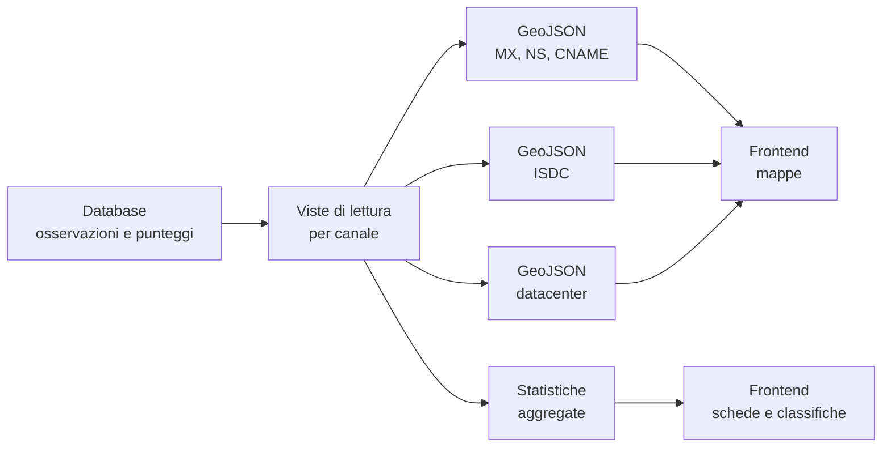

# La pubblicazione: GeoJSON e statistiche

## Due linguaggi per due bisogni

Il frontend dell'Osservatorio non interroga il database. Legge due famiglie di
file statici, prodotte alla fine della pipeline:

- i **GeoJSON**, che raccontano la dimensione geografica: un punto per ente,
  con le informazioni del canale o dell'indice;
- il **JSON statistico**, che racconta la dimensione aggregata: quante entità
  hanno un provider italiano, quanto è concentrato il mercato, quante sono in
  una banda.

La separazione non è casuale. La mappa ha bisogno di geometrie e di attributi
per punto; le statistiche hanno bisogno di totali, quote e classifiche. Sono
due letture diverse dello stesso fenomeno, e vengono prodotte in due passaggi
distinti.

## I livelli geografici

La mappa è composta da più livelli, uno per canale, più uno per l'indice e uno
per i datacenter. Ogni livello è un file autonomo, così il frontend può
mostrare, nascondere o combinare i canali senza rigenerare i dati.

| Livello | Contenuto | Informazione caratteristica |
|---|---|---|
| Posta | Enti con un mail exchanger osservato | Nome del server MX |
| Delega DNS | Enti con un nameserver osservato | Nome del nameserver |
| Web | Enti con una risoluzione web osservata | Nome finale, emittente e tipo di certificato |
| ISDC | Enti con un indice calcolato | Punteggio per canale, ASN e organizzazione, banda |
| Datacenter | Datacenter censiti in Italia | Nome, proprietario, indirizzo, tipo |

I primi tre livelli raccontano i singoli canali. Il livello ISDC è quello
sintetico: contiene i punteggi delle tre dimensioni, i provider associati a
ciascuna, l'emittente del certificato, il totale e la banda. È il livello che
permette al frontend di colorare la mappa in base alla sovranità e di costruire
il popup completo.

### Il punto rappresenta l'ente

Le coordinate di ogni punto sono quelle della sede dell'ente, non quelle del
provider o del datacenter. Il provider e il paese dell'infrastruttura sono
attributi del punto, non la sua posizione.

Questa scelta rende la mappa leggibile come una geografia delle
amministrazioni, ma impedisce di usarla per localizzare i server. Un ente con
sede in un comune e posta su un cloud americano appare nel comune, con il cloud
nella scheda. Per una mappa delle infrastrutture servirebbe un livello diverso,
basato sugli IP osservati.

### Gli enti senza coordinate

Non tutti gli enti hanno una posizione geografica. Quando le coordinate non
sono disponibili, il punto non viene inventato e non viene spostato. Il record
resta comunque nel file, con una coordinata sentinella che il frontend
riconosce e non disegna.

Per questo il numero di feature in un GeoJSON può essere maggiore del numero di
punti visibili sulla mappa. E per questo gli enti senza coordinate continuano a
contare nelle statistiche: la loro assenza dalla mappa è un fatto di
geolocalizzazione, non di perimetro.

## Il JSON statistico

Il file statistico è organizzato in sezioni. Ogni sezione contiene un titolo e
un insieme di **card**, cioè indicatori pronti per essere mostrati. Una card ha
un valore, un tipo e una descrizione breve.

### Le sezioni

| Sezione | Che cosa racconta |
|---|---|
| Base dati | Enti censiti, enti valutati, record per canale, datacenter |
| Tipologie di ente | Distribuzione degli enti per tipologia |
| Categorie di ente | Distribuzione per categoria IPA, mostrata come classifica |
| Posta (MX) | Copertura, quota in Italia, quota fuori UE, hyperscaler, top provider |
| Nameserver (NS) | Copertura, quota in Italia, quota fuori UE, concentrazione, top provider |
| Web e certificati (CNAME) | Copertura, quota in Italia, quota fuori UE, Let's Encrypt, top provider |
| ISDC | Media, massimo, minimo, enti nella banda alta e nella banda fragile |
| Vendor lock-in | Enti con stesso provider sui tre canali, con due canali uguali, con provider diversi, non determinabile |
| Concentrazione ASN | ASN unici, quota del primo provider, top cinque, indice di concentrazione |
| Resilienza | Enti con DNS centralizzato e con DNS distribuito |
| Cloud e hyperscaler | Quota di enti su cloud globale e conteggio assoluto |
| TLS | Certificati Let's Encrypt |
| Bande ISDC | Conteggio e percentuale per ogni banda |

Le card hanno tipi diversi: un **conteggio** è un numero assoluto, una
**percentuale** è una quota, un **punteggio** è un valore dell'indice, una
**lista** è una classifica, un **indice** è una misura normalizzata come
l'HHI.

### I denominatori non sono tutti uguali

Questa è la parte più facile da fraintendere. Le percentuali di canale non
hanno tutte lo stesso denominatore:

- per la **posta**, il denominatore è il numero di enti per cui esiste un MX
  con provider e paese risolti;
- per il **web**, il denominatore è il numero di enti per cui esiste un CNAME
  con provider e paese risolti;
- per la **delega DNS**, il denominatore è il numero di enti presenti nel
  canale NS, anche quando il provider non è identificato;
- per l'**ISDC**, le statistiche sono calcolate sugli enti che hanno un
  punteggio.

La differenza nasce dai join delle viste di lettura. Per MX e CNAME la vista
richiede che provider e paese esistano; per NS è più permissiva, perché un
nameserver può essere osservato senza che il suo provider sia risolto. Il
risultato è che i totali di canale possono differire tra loro e dal numero di
enti censiti.

Non è un errore: è la conseguenza di ciò che ciascun canale riesce a
osservare. Ma significa che una percentuale "in Italia" va letta sempre
rispetto al proprio denominatore, non rispetto al totale degli enti.

### Lock-in e concentrazione

La sezione sul lock-in classifica gli enti in quattro gruppi:

- **lock-in alto**: lo stesso sistema autonomo compare su posta, DNS e web;
- **lock-in parziale**: due canali condividono il provider;
- **distribuzione completa**: i tre canali hanno provider diversi;
- **non determinabile**: manca almeno un provider.

Le quattro categorie sono costruite per coprire tutti gli enti valutati. Gli
enti con un provider mancante non vengono forzati in una categoria che
affermerebbe un dato non verificato: finiscono in "non determinabile". La
somma dei quattro conteggi è un controllo di coerenza.

La concentrazione ASN usa invece tutti gli slot ente-canale. L'indice HHI è
normalizzato tra 0 e 1: valori bassi indicano un panorama distribuito, valori
alti indicano che pochi provider coprono la maggior parte degli slot. È
calcolato sugli slot, non sugli enti, perché un ente può contribuire con tre
provider diversi.

### I controlli di coerenza

Prima di scrivere il file, il generatore verifica alcune relazioni:

- la somma delle tipologie deve coincidere con gli enti censiti;
- la somma delle categorie deve coincidere con gli enti censiti;
- le categorie di lock-in devono coprire tutti gli enti valutati;
- le bande devono coprire tutti gli enti valutati e sommare al 100%;
- l'HHI deve essere compreso tra 0 e 1;
- le quote devono essere percentuali plausibili.

Se un controllo fallisce, la generazione lo segnala. È un presidio di qualità
interno: non garantisce che il dato sia giusto, ma impedisce che un errore
aritmetico passi silenziosamente nel frontend.

## Il registro dei cambiamenti

Accanto alle statistiche viene prodotto un file che raccoglie la **storia dei
cambiamenti** dei record DNS: quando un valore cambia, viene conservato il
valore precedente e quello nuovo, con la data e il tipo di operazione. È la
memoria delle variazioni, non solo la fotografia del presente.

Questo file permette al frontend di mostrare cosa è cambiato nel tempo: un
provider sostituito, un nameserver dismesso, un certificato diverso. È anche
uno strumento di trasparenza, perché rende verificabile l'evoluzione
dell'osservazione.

## Perché il frontend non interroga il database

Servire le mappe e le statistiche da file statici ha tre vantaggi:

- **prestazioni**: il frontend non deve eseguire query complesse;
- **separazione**: il database può essere aggiornato senza bloccare la
  consultazione;
- **riproducibilità**: un insieme di file corrisponde a una fotografia
  precisa dei dati.

Il prezzo è che il frontend mostra l'ultima pubblicazione, non lo stato del
database in tempo reale. Tra una generazione e l'altra possono esserci
differenze. La data di osservazione e la data di generazione aiutano a
collocare i risultati nel tempo.

## Che cosa il lettore può dedurre

Dai file pubblicati si può capire:

- quanti enti sono coperti da ciascun canale;
- quale quota di infrastrutture è collocata in Italia, in Europa o fuori;
- quali provider dominano la posta, il DNS e il web;
- quanto è concentrato il panorama;
- quanti enti hanno un lock-in alto o una distribuzione completa;
- come si distribuiscono le bande di sovranità.

Non si può dedurre:

- la qualità del servizio offerto dall'ente;
- la sicurezza dei sistemi;
- la residenza effettiva dei dati;
- la titolarità dei contratti;
- la posizione fisica dei server dietro una CDN.

Queste informazioni richiedono fonti diverse. I file pubblicati sono una
rappresentazione dell'infrastruttura osservabile, non una descrizione completa
dell'ente.
