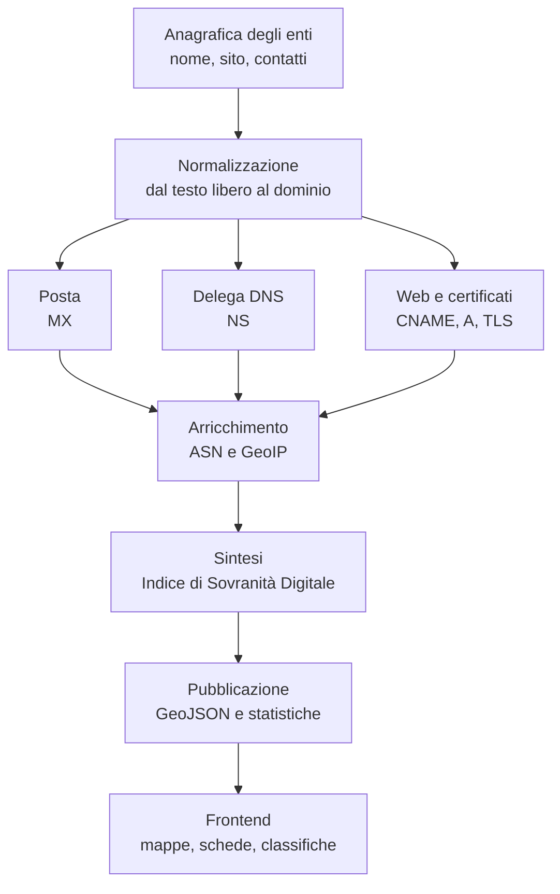

# Il viaggio di un dato

## Dalla pubblica amministrazione alla mappa

Ogni ente pubblico italiano ha un nome, una sede e, quasi sempre, un sito
istituzionale. Quel sito è la porta d'ingresso digitale dell'ente: da lì si
accede ai servizi, si leggono i comunicati, si scaricano i moduli, si scrive
alla casella di posta.

L'Osservatorio Sovranità Digitale parte proprio da questo punto apparentemente
semplice — un indirizzo web — e ricostruisce la catena di infrastrutture che lo
rendono raggiungibile. Non osserva le intenzioni dell'ente, non valuta la
qualità dei suoi servizi e non misura la sicurezza del sito. Osserva **dove**
e **presso chi** vivono le sue fondamenta digitali.

Questa documentazione racconta quel viaggio.

> **A chi è rivolta**
>
> È pensata per chi consulta il frontend dell'Osservatorio e vuole capire come
> sono stati costruiti i risultati che vede: mappe, schede, indicatori,
> classifiche. Il linguaggio è tecnico, ma non è un manuale del software. Non
> troverai comandi da eseguire, nomi di funzioni o query. Troverai invece la
> logica, le scelte metodologiche e le cautele necessarie per leggere i dati
> nel modo corretto.

## La domanda di fondo

La sovranità digitale, in questo progetto, non è un giudizio politico o
giuridico. È una **misura della dipendenza infrastrutturale**: quanta parte
della presenza digitale di un ente è ospitata, gestita o intermediata da
soggetti e territori esterni? E quanto è concentrata su pochi fornitori?

Per rispondere, l'Osservatorio guarda tre canali indipendenti ma complementari:

| Canale | Domanda a cui risponde | Segnale osservato |
|---|---|---|
| Posta elettronica | Dove viene gestita la posta dell'ente? | Record MX, provider, paese |
| Delega DNS | Chi controlla la risoluzione del dominio? | Nameserver, provider, paese |
| Web e certificati | Dove viene servito il sito e chi firma il certificato? | Catena CNAME, IP, TLS, emittente |

Sono tre prospettive diverse sulla stessa infrastruttura. Un ente può avere la
posta su un provider italiano, il DNS su un grande operatore internazionale e
il sito dietro una CDN globale. Oppure può concentrare tutto sullo stesso
fornitore. La combinazione dei tre segnali racconta una storia più ricca di
quella che racconterebbe ciascuno da solo.

## Il percorso del dato

Il viaggio si svolge in otto tappe. Ogni tappa aggiunge un livello di
interpretazione, senza mai perdere il legame con il dato osservato.

1. **Raccogliere l'anagrafica.** Si parte dall'elenco degli enti e dai loro
   dati di contatto, con il sito istituzionale come chiave di accesso.
2. **Riconoscere il dominio.** Il sito è un campo libero: può contenere URL,
   percorsi, porte, caselle di posta. Prima di interrogare la rete bisogna
   ricondurlo a un nome di host valido.
3. **Interrogare la posta.** Si cerca il mail exchanger dichiarato dal dominio
   e si risale al provider che lo gestisce.
4. **Interrogare la delega DNS.** Si individua il nameserver che risponde per
   la zona, risalendo la gerarchia quando necessario.
5. **Seguire il web.** Si ricostruisce la catena di alias, si trova l'indirizzo
   finale e si osserva il certificato TLS.
6. **Arricchire i dati.** Ogni indirizzo IP viene ricondotto a un sistema
   autonomo (ASN) e a una collocazione geografica.
7. **Sintetizzare.** I tre canali diventano un indice composito, con pesi,
   copertura e correzioni.
8. **Pubblicare.** I risultati vengono trasformati in file geografici e
   statistici che il frontend legge senza interrogare direttamente il database.

## Un racconto, non un elenco

La tentazione, di fronte a una pipeline dati, è raccontarla come una sequenza
di tabelle. Ma chi consulta il frontend non vede tabelle: vede un ente sulla
mappa, una scheda con il provider della posta, una banda di sovranità, una
classifica di concentrazione.

Per questo la documentazione segue il percorso del dato, non l'architettura del
software. Ogni capitolo risponde a una domanda del lettore:

- *Da dove arrivano i dati?*
- *Perché un sito può essere escluso?*
- *Che cosa significa che un ente ha un MX italiano?*
- *Perché il nameserver di una scuola può mancare?*
- *Che cosa misura davvero l'indice?*
- *Come devo leggere un valore mancante?*

## Tre livelli di lettura

Per orientarsi, è utile tenere distinti tre livelli.

**Il dato osservato.** È ciò che la rete restituisce in un certo momento: un
record MX, un nameserver, un certificato. È una fotografia, non una proprietà
permanente.

**Il dato derivato.** È il risultato di una trasformazione: la scelta del
provider, la classificazione dell'emittente, il punteggio di una dimensione.
Qui entrano in gioco euristiche e pesi, che vanno conosciuti per interpretare
il risultato.

**La lettura.** È il significato che attribuiamo al dato. Un provider estero
non è automaticamente un problema; un provider italiano non è automaticamente
garanzia di sovranità. La documentazione aiuta a distinguere l'osservazione
dall'interpretazione.

## Come proseguire

Se vuoi capire il quadro generale, continua con **Il racconto**. Se ti interessa
un singolo passaggio, puoi usare la navigazione laterale e andare direttamente
al capitolo corrispondente. In fondo trovi un **Glossario** per i termini
tecnici e un'**Appendice metodologica** con i criteri di calcolo dettagliati.
